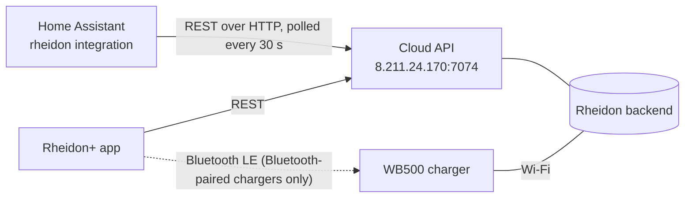
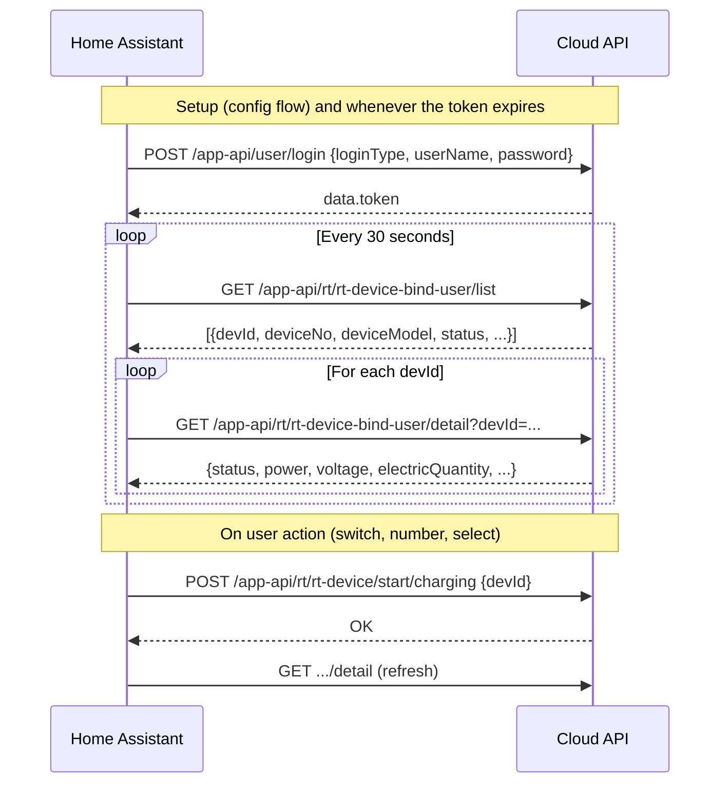

# How the Rheidon+ integration talks to the charger

The charger is never contacted directly. It holds a connection to the Rheidon
cloud, and both the Rheidon+ app and this integration talk to that cloud.

Everything here was reverse engineered from the Rheidon+ Android app, version
2.1.4. The app is built with uni-app, a JavaScript framework, so its logic lives
in `assets/apps/__UNI__CF8BE54/www/app-service.js` rather than in the Java code.
The findings were then checked against a capture of the iOS app's traffic
(mitmproxy) and live requests for a WB500-11K-C-EU. The iOS app uses the same
host and endpoints.



The integration uses only the REST API. The app also receives live push
updates through a separate channel, and can talk to Bluetooth-paired chargers
directly; the integration uses neither.

## REST API

### Transport

| | |
|---|---|
| Base URL | `http://8.211.24.170:7074` (plain HTTP, hardcoded in the app) |
| Request body | JSON (`Content-Type: application/json`) |
| GET parameters | query string |

The app also names `https://api.rheidon-tech.com` as a fallback host. It
resolves to the same IP, but its HTTPS endpoint fails the TLS/HTTP2 handshake
(checked 2026-10-20). Because the only working host is plain HTTP, **the
password and token travel unencrypted**, exactly as they do from the app. The integration's config flow lets you change the URL if Rheidon
ever moves the API to HTTPS.

Every request carries these headers:

| Header | Value |
|---|---|
| `Authorization` | `Bearer <token>`, not sent on login |
| `Accept-Language` | `en`, which selects the language of error messages |
| `timeutc` | the client's UTC offset, e.g. `UTC+2` |

### Response envelope

Every response is HTTP 200 with a JSON envelope:

```json
{"code": "200", "success": true, "message": "...", "data": { ... }}
```

| `code` | Meaning | What the integration does |
|---|---|---|
| `200`, `20001`, or `success: true` | OK | returns `data` |
| `A00004`, `A00006`, `A00007`, `U0230` | token missing or expired | logs in again and retries once |
| anything else | error, with the reason in `message` | raises an error |

Requests without a valid token get `U0230` ("用户登录已过期", login expired).
HTTP 401 is treated the same way. The app has no refresh-token flow; it simply
logs in again.

### Sequence



### Login

```
POST /app-api/user/login
{"loginType": "PHONE_EMAIL", "userName": "<email>", "password": "<password>"}
```

`data.token` (128 characters) is the bearer token, and `data.userInfo.userId`
is the user id. The app also supports `loginType` values `IPHONE`, `Gu_GE` and
`FACE_BOOK` with an OAuth `code`. The integration supports only email and
password.

**Passwords are truncated to 16 characters.** The iOS app's password field
silently cuts input off at 16 characters, so an account registered there has
only the first 16 characters as its password. Logging in with the full password
fails with `S5004` ("Incorrect account or password"), the same error as for an
unknown account. The integration first tries the password as entered, then
retries with its first 16 characters.

### Reading state

| Endpoint | Parameters | Returns |
|---|---|---|
| `GET /app-api/rt/rt-device-bind-user/list` | none | the chargers bound to the account |
| `GET /app-api/rt/rt-device-bind-user/detail` | `devId`, or `id` (the binding id), or `deviceNo` | one charger in full |
| `GET /app-api/rt/rt-device-charge-record/page` | paging | past charging sessions (not used) |
| `GET /app-api/rt/rt-device-charge-record/list` | `chargeRecordId` | power samples for a session, about every 2 minutes (not used) |
| `GET /app-api/rt/rt-device-charge-record/energy` | `chargeRecordId` | per-phase energy curve for a session (not used) |

`list` and `detail` return mostly the same fields, but `list` puts the session
energy in `electricity` (the L1 current) and leaves `electricQuantity` null.
`detail` has both right, so the integration lets `detail` override `list`.

The fields the integration reads from the device data:

| Field | Meaning | Entity |
|---|---|---|
| `devId` | device id, used in every command | (identity) |
| `deviceNo` | serial number | device info |
| `deviceModel` | e.g. `WB500-11K-C-EU` | device info |
| `phase` | number of phases (3); if missing, `7K2`/`3K6` models are single-phase | which L2/L3 entities exist |
| `devName`, `devVersion` | user-given name, firmware version | device info |
| `online` | connected to the cloud (`1`/`true`) | Online |
| `status` | see the table below | Status, Charging |
| `power`, `powerP2`, `powerP3` | power per phase, kW | Power, Power L1–L3 |
| `electricity`, `electricityP2`, `electricityP3` | current per phase, A | Current L1–L3 |
| `voltage`, `voltageP2`, `voltageP3` | voltage per phase, V | Voltage L1–L3 |
| `electricQuantity` | energy delivered since the car was plugged in, kWh. Keeps counting across pause and resume, and holds its value when idle. | Session energy |
| `chargeStartTime`, `chargeEndTime` | `YYYY-MM-DD HH:MM:SS` in the charger's `timeZone` | Charge start, Charge end |
| `chargeCurrent`, `maxCurrent` | current limit and its maximum, A | Charge current limit |
| `modeType` | `Plug Now`, `ECO`, `MAX` or `Manual` | Charging mode |
| `chargingYcModeStatus` | `1` when a delayed start is pending | (used by the switch) |
| `faultType` | fault description when `status` is 4 | Status attribute |

`status` values, from the app's `mapChargeRunStatus`:

| Value | Meaning |
|---|---|
| 1 | plugged in, not charging |
| 2 | charging |
| 3 | unplugged |
| 4 | fault |
| 5 | emergency stop |
| 6 | discharging |
| 7 | paused |

The units (kW, A, V, kWh) come from the labels the app shows next to these
values, and match recorded data: an 11 kW charger at 16 A reports about 3.3 kW
per phase and 9.94 kW in total. If `maxCurrent` is missing, the app assumes
16 A for models containing `11K` or `3K` and 32 A otherwise. The integration
does the same.

Timestamps use mixed time zones. `chargeStartTime` and `chargeEndTime` are in the
charger's `timeZone`. `lastReportTime`, `createTime` and the envelope's `time`
are in server time (UTC+8). The `timeutc` header doesn't change any of them in
`detail`, though charge-record times do follow it.

### Commands

All of these are `POST` with a JSON body.

| Action | Endpoint | Body |
|---|---|---|
| Start charging | `/app-api/rt/rt-device/start/charging` | `{devId}` |
| Start now, cancelling a delayed start | `/app-api/rt/rt-device/start/charging/hold` | `{devId}` |
| Stop charging | `/app-api/rt/rt-device/end/charging` | `{devId}` |
| Set current limit | `/app-api/rt/rt-device/set/charge/current` | `{devId, chargeCurrent}` |
| Set mode | `/app-api/rt/rt-device/set/charge/modeType` | `{devId, modeType}` |
| Delayed start (not used) | `/app-api/rt/rt-device/set/charge/delay2` | `{devId, chargingMode, chargingYcModeTime}` |
| Plug-and-charge (not used) | `/app-api/rt/rt-device/editPlugNow` | `{devId, plugNow: 0/1}` |
| Solar mode (not used) | `/app-api/rt/rt-device/change/pvEnabled` | `{devId, pvEnabled: 0/1}` |

The cloud passes each command on to the charger. The response confirms only that
the cloud accepted the command, so the integration refreshes afterwards to read
the new state.

## Bluetooth (not used)

Chargers paired over Bluetooth instead of Wi-Fi (they have a `bleId` and open
`productPro.vue` in the app) are controlled locally. The app sends short binary
commands over Bluetooth, each ending in a checksum byte: `0x01` start with a
current level, `0x02` stop, `0x03` delayed start, `0x05` sync time, `0x06`
plug-and-charge. It then reports the resulting state to the cloud through
`/app-api/rt/rt-device/ble/changeState`. Such chargers have no `devId` in the
device list, so the integration skips them.

## Behaviour while charging (verified 2026-10-20)

These results come from polling `detail` every 20 s during a charge:

- **Update interval:** `power*`, `electricity*` and `electricQuantity` update
  together every **2 minutes**. Between updates, `detail` returns the same
  values, so polling every 30 s adds at most about 30 s of extra delay. The app
  gets faster updates through its push channel.
- **Session scope:** `electricQuantity` covers the whole time the car is
  plugged in, not a single charge. When charging resumed after a pause, it
  continued from 12.71 to 13.22 kWh and `chargeStartTime` didn't change. The
  increase of 0.13–0.14 kWh every 2 minutes matches the reported 4.19 kW.
- **`lastReportTime`** didn't change while the meter values updated, so it
  appears to track status changes rather than meter samples.

## Open questions

- Does `electricQuantity` restart at 0 after unplugging and plugging in again?
  The Energy dashboard counts a large drop as a meter reset, so either way the
  totals stay correct as long as the value never drops in the middle of a
  session.
